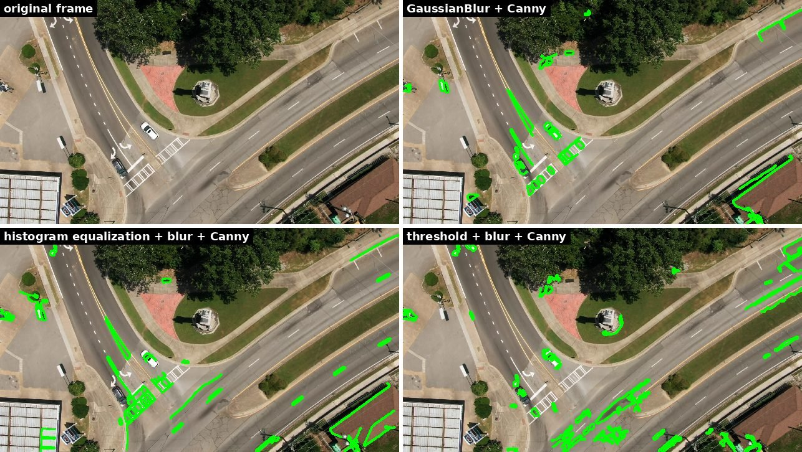
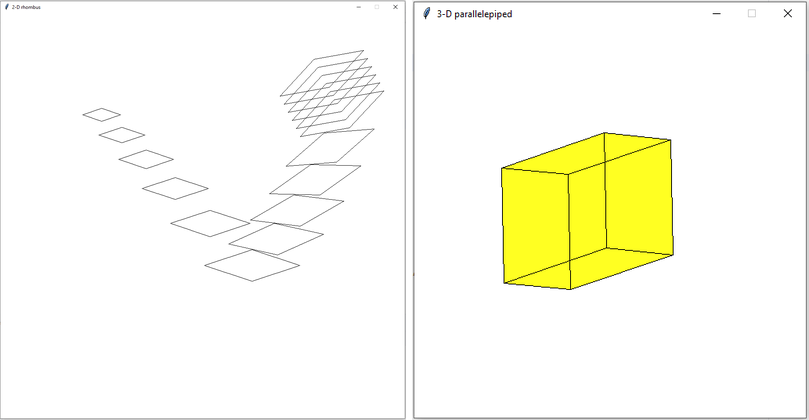
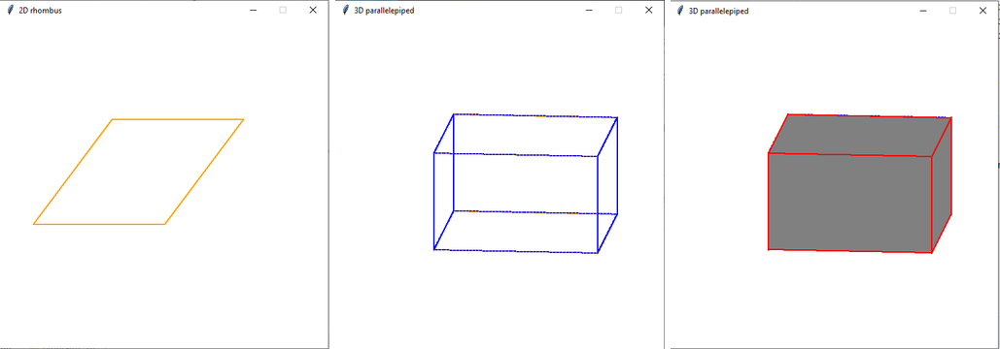
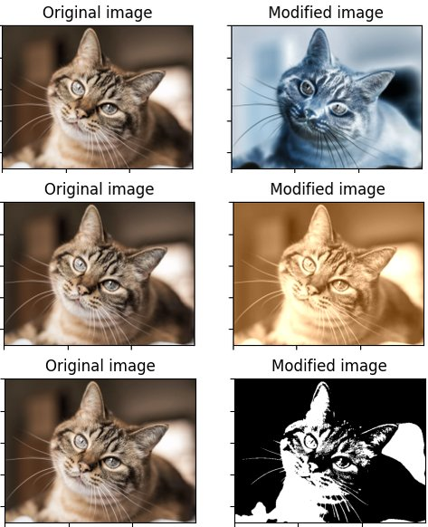
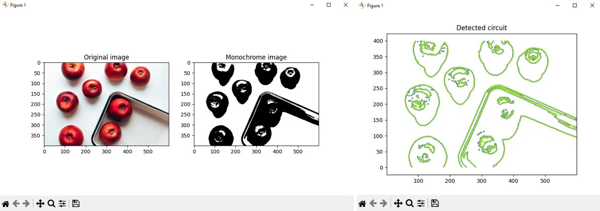
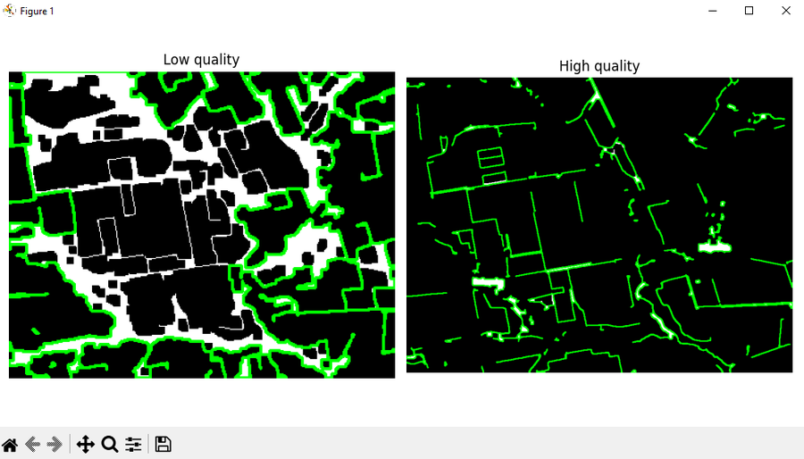
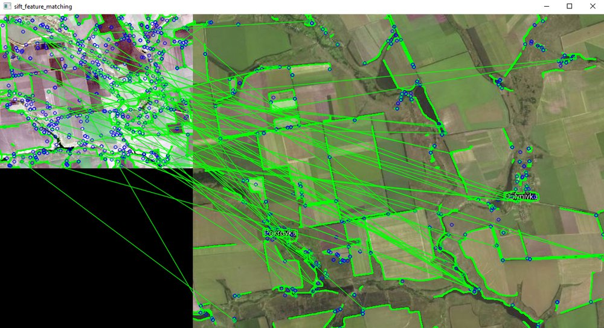
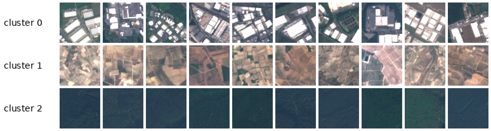
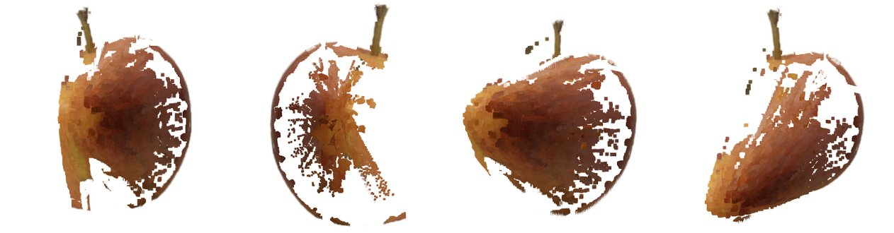
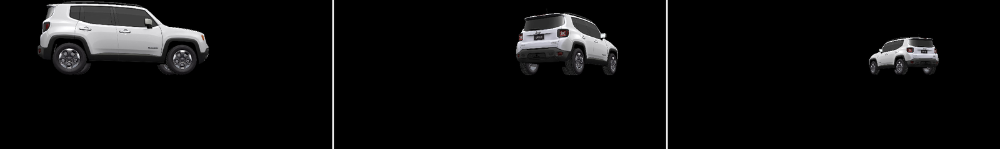

# 👁️ Computer Vision with OpenCV and Python

A collection of computer vision projects I built during one semester, going from hand-written transformation matrices and pixel loops up to feature matching, CNN features, stereo reconstruction and a small OpenGL scene. Each folder is a self-contained topic with its own script(s), so you can run them independently.



🎓 Computer Vision Technologies course, Igor Sikorsky Kyiv Polytechnic Institute (3rd year, autumn 2024).

## What's inside

| Folder | Topic | Main tools |
|--------|-------|------------|
| `geometric-transforms/` | 2D/3D transforms, axonometric projection, Bresenham and Bézier lines, painter's algorithm | NumPy, Zelle `graphics.py` (Tkinter) |
| `image-correction/` | brightness, grayscale, negative, sepia with gradients, noise, threshold; contour plotting | Pillow, Matplotlib |
| `vehicle-detection/` | detecting cars in an aerial highway video with three preprocessing pipelines | OpenCV |
| `satellite-segmentation/` | farmland field boundaries on Landsat vs Bing Maps imagery | OpenCV |
| `feature-matching/` | SIFT keypoints + FLANN matching between the two satellite sources | OpenCV |
| `clustering/` | unsupervised grouping of satellite tiles by VGG16 features | Keras, scikit-learn |
| `tracking/` | MeanShift object tracking in a video | OpenCV |
| `stereo-3d/` | 3D point cloud of an apple from three photos | OpenCV StereoSGBM, Open3D |
| `ar-scene/` | textured car model driving through an OpenGL scene | PyOpenGL, pygame |

## Geometry and raster basics

**Transforms.** Shapes are stored as extended (homogeneous) coordinate matrices, and every operation is a matrix product. `rhombus_transforms.py` scales, rotates and translates a rhombus step by step, leaving the trajectory on screen. `parallelepiped_rotation.py` rotates a box around its own vertical axis (translate to origin, rotate, translate back), applies an axonometric projection, and cycles the face colour through a yellow → cyan → white gradient.

**Lines, curves and hidden surfaces.** `bezier_rhombus.py` and `bezier_hidden_surfaces.py` draw edges pixel by pixel with Bresenham's algorithm and with quadratic Bézier curves, and the 3D version then hides invisible faces with the painter's algorithm (faces sorted by average depth and filled back to front).




**Colour correction.** `image_correction.py` works directly on the raster through Pillow's pixel access: brightness shift, grayscale, negative, noise, monochrome threshold and sepia. Sepia can be applied uniformly or blended in through a gradient mask: along any of the four diagonals, from the centre outwards or towards the centre. `contour_detection.py` plots iso-contours of an image and can run the monochrome threshold first to get cleaner object outlines.

 

## Detection and matching

**Vehicle detection.** Each frame of a 1080p aerial highway video is downscaled 3× and goes through three pipelines shown side by side:

1. grayscale → Gaussian blur → Canny;
2. histogram equalization (computed from the CDF by hand, with the histogram plotted for the first frame) → blur → Canny;
3. binary threshold at 128 → blur → Canny.

External contours are kept only if their bounding box is 5–100 px and their area is 30–150 px², which roughly matches a car at this scale.

**Satellite segmentation.** The same farmland area was captured from Landsat Explorer (low resolution) and Bing Maps (high resolution). Both images go through blur → Canny → morphological closing with a 7×7 kernel, and external contours are extracted. The field structure survives much better on the high-resolution source: **70 contours on Bing vs 8 on Landsat**.



**Feature matching.** SIFT descriptors are computed on the preprocessed images and matched with a FLANN k-d tree (k = 2). Lowe's ratio test with 0.8 keeps the reliable pairs, and the share of matches that pass it is reported as the identification probability: **70 good matches, ≈ 0.10**.



**Clustering.** Thirty 64×64 EuroSAT tiles (forest, industrial, permanent crop) are upscaled to 224×224 and passed through VGG16 without its classifier head, using global average pooling to get one 512-value feature vector per image. K-Means (k = 3, k-means++) groups them, and each file is copied into `result_images/` with its cluster id as a prefix. All three classes end up in their own cluster, 10/10/10:



**Tracking.** `meanshift_tracking.py` lets you select a region in the first frame, builds a hue histogram of it and follows the object with `cv2.meanShift` on the back-projection of every next frame.

## 3D

**Stereo reconstruction.** Three photos of an apple taken from slightly different angles are processed as two stereo pairs (left–middle, middle–right). For each pair `StereoSGBM` computes a disparity map, `reprojectImageTo3D` turns it into points using a reprojection matrix with focal length 0.8·width, and the two clouds are merged into one coloured `.ply` file (about 127k points) that is opened in an Open3D viewer.



**AR scene.** `car_animation.py` contains a small OBJ/MTL parser (polygons are fan-triangulated), loads the texture into OpenGL and renders the car with a perspective camera. Every frame the model moves forward and turns slightly, which gives a simple synthetic scene of a driving car that could be used to generate training images for a detector.



## Running

Python 3.10+ is needed (the scripts use `match`). Tkinter is required for `geometric-transforms/` (it ships with most Python installers; on Debian/Ubuntu install `python3-tk`).

```bash
git clone https://github.com/pgerasymchuk/computer-vision-opencv.git
cd computer-vision-opencv
pip install -r requirements.txt
```

Then run any script, for example:

```bash
python geometric-transforms/bezier_hidden_surfaces.py   # click the window to advance
python satellite-segmentation/farmland_contours.py
python feature-matching/sift_flann_matching.py
python clustering/vgg16_kmeans_clustering.py            # downloads ImageNet weights on first run
python stereo-3d/stereo_reconstruction.py
```

The satellite images, EuroSAT tiles and apple photos are included. A few scripts need your own media:

- `image-correction/image_correction.py [image]` and `contour_detection.py` (asks for a path): any RGB photo, `image.jpg` / `input.jpg` by default;
- `vehicle-detection/vehicle_detection.py [video]`: a top-down road video, `video.mp4` by default;
- `tracking/meanshift_tracking.py [video]`: any video with a moving object; select it with the mouse and press Enter;
- `ar-scene/car_animation.py`: put a textured OBJ model as `model.obj`, `model.mtl` and `texture.jpg` next to the script.

Press `q` to stop the video windows.

## Project structure

```
geometric-transforms/     matrix transforms, Bresenham/Bézier edges, painter's algorithm
image-correction/         pixel-level colour correction and contour plotting
vehicle-detection/        three OpenCV pipelines for cars in a highway video
satellite-segmentation/   field contours on Landsat and Bing images (+ the two images)
feature-matching/         SIFT + FLANN matching of the satellite images
clustering/               VGG16 features + KMeans on EuroSAT tiles
tracking/                 MeanShift tracker
stereo-3d/                multi-view stereo point cloud (+ three photos)
ar-scene/                 PyOpenGL/pygame car animation
docs/                     result screenshots used in this README
```

## Tech stack

- Python 3, NumPy
- OpenCV (Canny, contours, morphology, SIFT, FLANN, MeanShift, StereoSGBM)
- Pillow and Matplotlib for raster processing and plots
- Keras/TensorFlow (VGG16) and scikit-learn (K-Means)
- Open3D for point clouds
- PyOpenGL and pygame for 3D rendering
- John Zelle's `graphics.py` (GPL, included unchanged) on top of Tkinter
